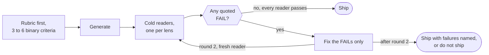

<div align="center">



<h1>cold-read</h1>

<p><b>A Claude skill that reads finished work blind before it leaves your hands.</b></p>

<p>
<a href="https://github.com/EauDoon/cold-read/actions"></a>
<a href="https://github.com/EauDoon/cold-read/blob/main/LICENSE"></a>
</p>

<p>
<a href="https://eaudoon.github.io/cold-read/">3D explainer</a> ·
<a href="#quick-start">Quick&nbsp;start</a> ·
<a href="#when-it-fires">When&nbsp;it&nbsp;fires</a> ·
<a href="#the-loop">The&nbsp;loop</a> ·
<a href="#the-report">The&nbsp;report</a> ·
<a href="#what-it-costs">Cost</a>
</p>

</div>

The author of a draft is the worst reader of it. A context that wrote the work and then checks it inherits its own frame: it catches typos and misses the wrong premise, such as a page that breaks a limit the same author set three pages earlier. cold-read hands the finished artifact to readers that never saw it being made, one per lens, and blocks it on any single quoted failure.

It is the evaluator-optimizer loop with the evaluator made independent, plus the rules that keep it honest: the rubric is written before the draft, every FAIL carries a verbatim quote, numbers close only by a script the main thread runs, and the loop stops after two revision rounds.

## Quick start

It needs an agent that can run subagents or fresh sessions. A second model family as the reader is strongest.

```bash
git clone https://github.com/EauDoon/cold-read
```

For every project (personal skills):

```bash
mkdir -p ~/.claude/skills && cp -r cold-read/.claude/skills/cold-read ~/.claude/skills/
```

For one project:

```bash
mkdir -p your-project/.claude/skills && cp -r cold-read/.claude/skills/cold-read your-project/.claude/skills/
```

For the Claude apps, build a zip with the skill folder at its root and upload it under Customize > Skills:

```bash
cd cold-read/.claude/skills && zip -r cold-read.zip cold-read
```

It fires on its own when a finished artifact is about to leave, or call it by name:

```
check this term sheet before I send it
```

```
/cold-read tear this deck apart, it goes to the board on Thursday
```

## When it fires

All three must hold. Two of three is a smell. One of three is a tax.

1. The work leaves the building: a third party will read it or act on it.
2. The pass bar can be stated before the draft exists.
3. Being wrong costs money, reputation or a decision.

Three classes fire without asking, because the class itself meets the gate: anything a lawyer will read (contract, term sheet, MOU, engagement letter, annex), arithmetic someone is paid against (invoice, reconciliation, revenue share, fee schedule), and external deliverables (a deck, memo or one-pager going outside, or a figure a counterparty will act on). Chat answers, internal notes and drafts still finding their shape never fire it.

| Tier | When | Readers |
|---|---|---|
| **LITE** | The default | One cold reader on the full rubric, one round |
| **FULL** | Someone signs it, pays against it, or acts on it in public with money or reputation at stake. Or "tear this apart" | One reader per lens, up to two revision rounds |
| **DELTA** | A bounded revision of work with a run logged in the last 14 days | The changed sections, every time-sensitive claim, the brief lens, and every numeric script rerun in full |

A contract or paid-against arithmetic never runs below LITE, whatever the label. "Draft the term sheet" runs FULL, because "draft" names the artifact, not the effort.

## The loop



1. **Rubric first.** Three to six criteria, each binary, quotable, and checkable by someone who was not there. A criterion you cannot fail by pointing at text is a mood.
2. **Generate** normally, without writing for the evaluator.
3. **Cold read.** Each reader gets the artifact, the rubric and one named lens, and nothing about how the work was made. Lenses: evidence, internal consistency, mechanical style, the hostile reader, the brief, and names. The brief lens sees only the original request and the artifact, and catches the most expensive failure: perfect work that answers the wrong question.
4. **Asymmetric quorum.** One quoted FAIL is a FAIL. A PASS needs every reader. In the first proof run, the sharpest finding came from one reader of three.
5. **Revise the FAILs, and only the FAILs.** Anything else is a new draft and voids the round.
6. **Stop.** A fresh reader rereads once. The loop ends when every criterion passes, when round two flips nothing, or after two revision rounds. There is no round three.
7. **Log** one row per run in a store that outlives the session.

Numeric criteria never close by assertion. A reader returns a runnable script with the inputs hardcoded, the main thread runs it, and an unchecked number bars a clean verdict. The full loop rules, each with the failure that earned it, are in [references/loop-rules.md](.claude/skills/cold-read/references/loop-rules.md).

## The report

Four lines, every time it runs. It never runs silently and never asks permission first.

```
Cold read: FULL (contract), 2 rounds, ~400k tokens, 18 min. PASS WITH NOTES.
Changed: <every changed clause, figure or sentence on a contract or post; else up to five, then a count>
Your call: <open decisions with a recommendation>
Not checked: <each unchecked criterion and why>
```

Verdicts: **CLEAN** (nothing open, nothing unchecked), **PASS WITH NOTES** (no FAIL open, decisions or unchecked criteria listed), **BLOCKED** (a FAIL open, or an unchecked number on paid-against arithmetic).

## What it costs

Measured on logged runs, each in its own unit:

| Run | Readers and rounds | Spend |
|---|---|---|
| Proof run, long document, 06-08-2026 | 3 readers, 1 round | about 270k tokens, 7 minutes (unit not recorded) |
| Three-page static site, FULL, 28-10-2026 | 2 rounds | about 645k evaluator output tokens, 45 minutes |
| Same site, second log, 28-10-2026 | 4 readers by 2 rounds | about 1.93M subagent tokens, input and output |

Right for a contract or a board deck, absurd for a tweet. Scale readers to what being wrong costs, not to how much the work matters to its author. A run checkpoints at 60 minutes or 1.2M evaluator output tokens.

## Neighbours

| Skill | Owns | Split |
|---|---|---|
| [gauntlet-verify](https://github.com/EauDoon/gauntlet-verify) | Work in flight: a build held to a named reference, or research verified while it is drafted | In flight versus finished and shipping |
| Your prose style guide | The prose bar | It is the bar, cold-read runs the check |

## Repository

```
.claude/skills/cold-read/SKILL.md              the skill
.claude/skills/cold-read/references/           loop rules, with the failure behind each
evals/evals.md                                 ten graded cases
docs/                                          the 3D explainer page (three.js bundled, no CDN)
scripts/check_skill.py                         frontmatter, references, house style, privacy checks
```

`python3 scripts/check_skill.py` runs in CI on every push. To view the explainer from a checkout, serve `docs/` with any static server, for example `python3 -m http.server -d docs`.

## License

[CC BY 4.0](LICENSE). The explainer page bundles [three.js](https://threejs.org) under its MIT license, in `docs/vendor/`.
